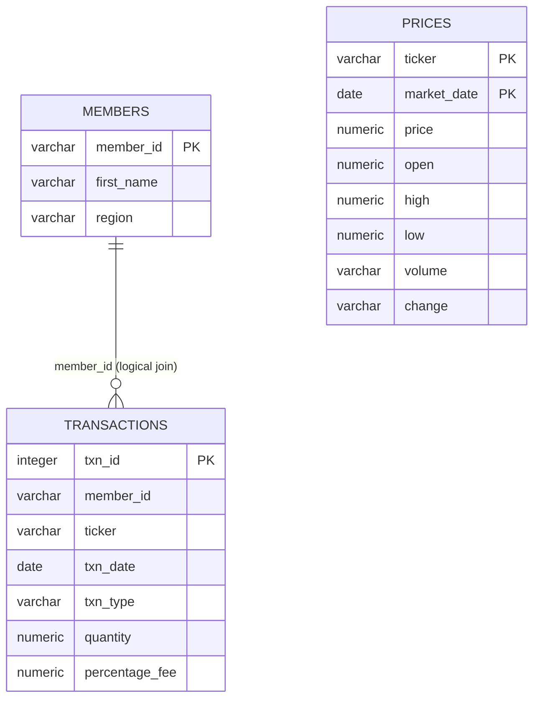

# Cryptocurrency Market & Trading Analysis

**SQL portfolio project | PostgreSQL | Cryptocurrency market analysis | Transaction analytics**

A descriptive SQL analysis of Bitcoin (BTC) and Ethereum (ETH) market observations, member information, and buy/sell transactions for 2020. The project uses PostgreSQL to explore historical price patterns, trading activity, and member-level transaction behaviour.

> This is a historical, descriptive analytics project. It is not a live market tracker, investment recommendation, or trading-strategy backtest.

## Project overview

The project brings together three datasets to answer practical analytical questions:

- How did BTC and ETH recorded prices behave during 2020?
- How often was each asset's recorded price above or below its opening price?
- What did buy and sell activity look like for each asset?
- How were members distributed across regions?
- Which members had the highest net recorded BTC transaction quantity?

### Dataset at a glance

| Dataset | Records | Grain | Purpose |
|---|---:|---|---|
| `prices.csv` | 732 | One asset per market date | Daily BTC and ETH price, open, high, low, volume and change |
| `transactions.csv` | 5,047 | One row per transaction | Member, asset, transaction date, BUY/SELL type, quantity and fee |
| `members.csv` | 14 | One row per member | Member ID, first name and region |

**Coverage:** The price data contains 366 daily observations for each asset, from 1 January to 31 December 2020. The transaction data contains 5,047 transaction IDs and references all 14 members.

## Data model



- `prices`: composite primary key on `(ticker, market_date)`.
- `transactions`: primary key on `txn_id`.
- `members`: primary key on `member_id`.
- Transactions are associated with members through `transactions.member_id = members.member_id`. This is a logical join in the analysis; the current SQL script does **not** declare a database foreign-key constraint.

## Analysis performed

### 1. Member and regional analysis

- Retrieve the first three members in alphabetical order.
- Filter members from the United States.
- List members outside Australia.
- Identify distinct regions in reverse alphabetical order.
- Count members by region.
- Compare United States and non-United States member counts.

### 2. Market data analysis

- Count total price records and records by ticker.
- Find the minimum and maximum market date for each asset.
- Calculate monthly average ETH prices.
- Count BTC days where the recorded daily high exceeded 20,000.
- Compare each day's recorded `price` with its `open` value.
- Calculate breakout and non-breakout percentages for BTC and ETH.

Here, **breakout day** means `price > open`, while **non-breakout day** means `price < open`. These are simple price-versus-open comparisons, not technical trading signals or return calculations.

### 3. Trading and member analysis

- Count BTC BUY and SELL transactions.
- Identify members with less than 500 BTC sold.
- Calculate buy-to-sell quantity ratios separately for BTC and ETH.
- Rank the top three members by net recorded BTC transaction quantity.

The buy-to-sell ratio is calculated separately by ticker because BTC and ETH quantities are different units. `NULLIF()` prevents division-by-zero errors when a member has no sell quantity.

## Key findings

The following figures are calculated from the CSV records in this repository. They describe this dataset only.

### Market price summary

| Metric | BTC | ETH |
|---|---:|---:|
| Daily observations | 366 | 366 |
| Average recorded price | 11,111.63 | 307.30 |
| Minimum recorded price | 4,826.00 | 107.90 |
| Maximum recorded price | 28,949.40 | 751.80 |
| Days with `price > open` | 207 (56.56%) | 200 (54.64%) |
| Days with `price < open` | 159 (43.44%) | 166 (45.36%) |

The source files do not specify the price currency, so no currency symbol is assigned.

Additional observations:
- BTC recorded 16 days where the daily high was above 20,000.
- ETH's monthly average recorded price rose from 156.65 in January to 622.35 in December.
- No duplicate ticker/date combinations are present in the supplied price data. The SQL table's composite primary key also prevents duplicate combinations from being inserted.

### Transaction activity

| Asset | Transactions | BUY count | SELL count | BUY quantity | SELL quantity | Net recorded quantity |
|---|---:|---:|---:|---:|---:|---:|
| BTC | 2,806 | 2,350 | 456 | 11,748.757556 | 2,301.977496 | 9,446.780059 |
| ETH | 2,241 | 1,833 | 408 | 9,284.277639 | 2,026.187564 | 7,258.090076 |
| **Total** | **5,047** | **4,183** | **864** | — | — | — |

Net recorded quantity is calculated as BUY quantity minus SELL quantity. BTC and ETH quantities are not combined.

Across all transactions, BUY records account for approximately 82.88% and SELL records for 17.12%.

### Member distribution

| Region | Members |
|---|---:|
| United States | 7 |
| Australia | 4 |
| Africa | 1 |
| India | 1 |
| Asia | 1 |
| **Total** | **14** |

### Top three members by net recorded BTC transaction quantity

| Member | Region | Net BTC transaction quantity |
|---|---|---:|
| Ayush | United States | 954.855948 |
| Leah | Asia | 921.610895 |
| Abe | United States | 859.371878 |

This metric represents the net flow in the supplied transaction records. It is **not** a verified wallet balance because opening holdings, deposits, withdrawals and external transfers are not included.

## SQL concepts demonstrated

- Relational table creation and primary keys
- Data insertion using `INSERT INTO`
- Filtering, sorting and limiting with `WHERE`, `ORDER BY` and `LIMIT`
- Aggregations using `COUNT`, `SUM`, `AVG`, `MIN` and `MAX`
- Conditional logic and aggregation using `CASE`
- Common Table Expressions (CTEs)
- Joins between transaction and member data
- Date analysis using `EXTRACT()`
- Duplicate-date checks and composite-key design
- Safe ratio calculations using `NULLIF()`

## Repository contents

```text
SQL-Project-Crypto/
├── README.md
├── add_CRYPTO.sql      # Table creation, data inserts and analysis queries
├── members.csv         # Member reference data
├── prices.csv          # 2020 BTC/ETH daily market observations
└── transactions.csv    # BUY/SELL transaction records
```

## How to run

**Requirements:** PostgreSQL and `psql`.

1. Create a new, empty PostgreSQL database.
2. Run the script from your terminal:

```bash
createdb crypto_analysis
psql -d crypto_analysis -f add_CRYPTO.sql
```

The `add_CRYPTO.sql` script creates the three tables, inserts the records, and runs the analysis queries. The CSV files are included as source/reference files; the SQL script loads data through embedded `INSERT` statements rather than importing the CSVs.

**Important:** The script does not drop existing tables before creating them. Run it against a new, empty database. Re-running it in the same database will fail when it attempts to create tables that already exist.

## Data notes and limitations

- The price currency is not specified in the supplied files.
- `volume` and `change` are stored as text in the SQL table because the source values include suffixes and percentage signs.
- The raw `transactions.csv` export contains four trailing empty columns after its seven meaningful fields; remove those empty columns if importing the CSV directly.
- The meaning and calculation basis of `percentage_fee` are not documented.
- The daily market price is not necessarily the execution price of an individual transaction.
- Net transaction quantity is not equivalent to a wallet balance.
- The member dataset contains only 14 records and should not be treated as representative of a wider customer population.
- The transaction-to-member relationship is used through a join, but a foreign-key constraint is not defined in the SQL schema.
- The duplicate-date query is a post-load check; because `prices` has a composite primary key, duplicate ticker/date rows would be rejected during insertion.
- Dataset source attribution and licensing details were not included in the repository.

The figures above were cross-checked against the committed CSV records and SQL insert counts. The SQL was reviewed statically; execute it in PostgreSQL to verify runtime behaviour in your own environment.

## Author

**Raj Kishore Agrawal**

- [GitHub](https://github.com/rraj12345)
- [LinkedIn](https://www.linkedin.com/in/rajagrawal1/)
