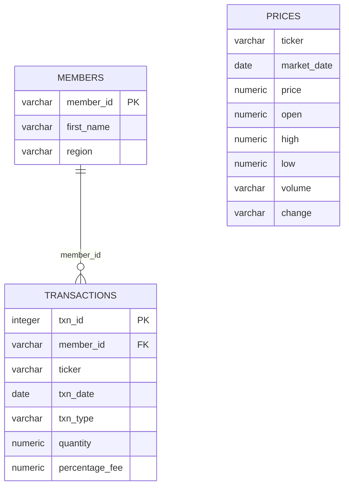

# Cryptocurrency Market & Trading Analysis

**SQL portfolio project | PostgreSQL | Market analysis | Transaction analytics | Member segmentation**

A descriptive analytics project built with historical Bitcoin (BTC) and Ethereum (ETH) market observations, member reference data, and buy/sell transactions for 2020. The project uses PostgreSQL to explore price behaviour, transaction mix, member activity, and the relationship between trading records and market data.

> **Project structure:** This README follows a CRISP-DM-inspired analytics narrative: Business Understanding → Data Understanding → Data Preparation → Analysis → Findings & Business Implications → Reproducibility.

## 1. Business understanding

### Business problem

A cryptocurrency platform needs a simple way to understand historical asset-price behaviour and customer trading activity. Looking at market prices alone does not explain how members trade; transaction data alone does not show the market context around those trades.

This project combines three related datasets to explore:

- **Market monitoring:** How did BTC and ETH prices vary during 2020?
- **Market movement:** How often was the recorded price above or below the opening price?
- **Trading activity:** How many buy and sell transactions were recorded for each asset?
- **Member analytics:** How are members distributed across regions, and which members recorded higher BTC net transaction quantities?
- **Data reliability:** Are price dates unique by ticker, and do transaction records link to the member table?

### Project objectives

1. Understand the coverage and structure of the market-price data.
2. Summarize monthly ETH price levels and BTC/ETH price-versus-open patterns.
3. Measure buy/sell transaction counts and quantities by asset.
4. Explore member-level and regional activity.
5. Present clear, reproducible SQL analysis and summarize the findings.

## 2. Data understanding

The repository contains three CSV source files and a SQL script with table creation and insert statements.

| Dataset | Records | Columns | Grain | Role |
|---|---:|---:|---|---|
| `prices.csv` | 732 | 8 | One row per asset per market date | BTC/ETH recorded price, open, high, low, volume and daily change |
| `transactions.csv` | 5,047 | 7 meaningful fields | One row per transaction | Member, asset, date, BUY/SELL type, quantity and percentage fee |
| `members.csv` | 14 | 3 | One row per member | Member ID, first name and region |

**Coverage:** The price dataset contains **366 daily observations for BTC and 366 for ETH**, covering 1 January to 31 December 2020. The transaction dataset contains **5,047 unique transaction IDs** and references all 14 members.

### Data model



The member relationship is `members.member_id = transactions.member_id`. Market observations are identified by `ticker + market_date`; they can be compared with transactions by asset and date, but the recorded daily market price is not necessarily the execution price of an individual trade.

## 3. Data preparation and quality

The project uses three related datasets: daily market prices, member reference data, and buy/sell transaction records. The SQL workflow creates and populates the `prices`, `transactions`, and `members` tables before running the analysis.

Data preparation and validation include:

- Reviewing record counts and date coverage for BTC and ETH.
- Checking that each asset has one market observation per date.
- Reviewing transaction identifiers and member references.
- Parsing transaction dates consistently as day-month-year values.
- Keeping the two asset types separate when comparing transaction quantities.

The analysis script is available in **[`add_CRYPTO.sql`](add_CRYPTO.sql)**. The CSV files are also included for reference and independent exploration.

## 4. Analysis performed

### A. Member and regional analysis

Questions explored include:

- Top three members alphabetically.
- Members from the United States.
- Member IDs and names for members outside Australia.
- Distinct regions in reverse alphabetical order.
- Member count by region.
- United States versus non-United States member counts.

### B. Market data coverage and quality

Questions explored include:

- Total price records and records per ticker.
- Minimum and maximum market date for each ticker.
- Whether duplicate market dates exist for a ticker.
- Number of BTC observations where the daily high is above 20,000.

### C. Price movement analysis

Questions explored include:

- Monthly average ETH price in 2020.
- Number of breakout days where recorded `price > open`.
- Number of non-breakout days where recorded `price < open`.
- Breakout and non-breakout percentages for each ticker.

These are descriptive price-versus-open measures. They are not a full volatility model, investment return calculation, or trading strategy backtest.

### D. Trading and member behaviour

Questions explored include:

- BTC buy and sell transaction counts.
- Members with less than 500 BTC sold, ordered from the largest quantity sold to the smallest.
- Member buy-to-sell ratio by quantity.
- Top three members by BTC quantity at the end of the period.

The buy-to-sell ratio is calculated **separately for BTC and ETH** because quantities of different cryptocurrencies are not directly comparable. The top-three member analysis uses net recorded BTC transaction quantity (BUY minus SELL); it is not a verified wallet balance because no opening balance is supplied.

## 5. Quantitative findings

The following figures were calculated directly from the committed CSV datasets using the definitions described below. They are historical descriptive measures for 2020, not live market data.

### Market-price summary

| Metric | BTC | ETH |
|---|---:|---:|
| Daily observations | 366 | 366 |
| Average recorded price | 11,111.63 | 307.30 |
| Minimum recorded price | 4,826.00 | 107.90 |
| Maximum recorded price | 28,949.40 | 751.80 |
| Days with `price > open` | 207 (56.56%) | 200 (54.64%) |
| Days with `price < open` | 159 (43.44%) | 166 (45.36%) |

The source repository does not explicitly document the currency unit for the price fields, so the table reports the recorded numeric price values without assigning a currency symbol.

Additional market observations:

- BTC had **16 days** where the recorded daily high exceeded 20,000.
- ETH's monthly average recorded price increased from **156.65 in January** to **622.35 in December**.
- No duplicate market-date observations were found for either ticker in the supplied price data.

### Transaction activity

| Asset | Transactions | BUY count | SELL count | BUY quantity | SELL quantity | Net recorded quantity |
|---|---:|---:|---:|---:|---:|---:|
| BTC | 2,806 | 2,350 | 456 | 11,748.757556 | 2,301.977496 | 9,446.780059 |
| ETH | 2,241 | 1,833 | 408 | 9,284.277639 | 2,026.187564 | 7,258.090076 |
| **Total** | **5,047** | **4,183** | **864** | — | — | — |

Net recorded quantity is calculated as BUY quantity minus SELL quantity for the supplied transaction records. BTC and ETH quantities are kept separate and are not added together.

### Member distribution

| Region | Members |
|---|---:|
| United States | 7 |
| Australia | 4 |
| Africa | 1 |
| India | 1 |
| Asia | 1 |
| **Total** | **14** |

The United States accounts for 7 of the 14 supplied member records (50%); Australia accounts for 4 (about 28.57%).

### Top three members by net recorded BTC transaction quantity

| Member | Region | Net BTC transaction quantity |
|---|---|---:|
| Ayush | United States | 954.855948 |
| Leah | Asia | 921.610895 |
| Abe | United States | 859.371878 |

This is a net transaction-flow measure, not a wallet balance or proof of current holdings.

## 6. Business interpretation

- **Trading mix:** BUY transactions account for 4,183 of 5,047 transactions (about 82.88%); SELL transactions account for 864 (about 17.12%). This describes the records in the dataset, not platform-wide market demand.
- **Asset activity:** BTC has 2,806 transaction records versus 2,241 for ETH in this sample.
- **Price-versus-open pattern:** BTC's recorded price is above open on 56.56% of days; ETH's is above open on 54.64%. This is a simple daily direction indicator, not a measure of return magnitude.
- **Member footprint:** Half of the supplied member records are from the United States. The small 14-member sample is not sufficient to generalize to a full customer base.
- **Net transaction quantity:** Ayush, Leah and Abe have the three largest net BTC transaction quantities under BUY-minus-SELL logic. This does not account for balances held before the transaction period or transfers outside the dataset.

## 7. SQL skills demonstrated

- Relational table design and primary keys
- Bulk data population with SQL `INSERT` statements
- Filtering, sorting and limiting
- Aggregations: `COUNT`, `SUM`, `AVG`, `MIN`, `MAX`
- Conditional aggregation with `CASE`
- CTEs for member-level transaction summaries
- Joins between transaction and member tables
- Date functions: `EXTRACT`
- Duplicate-date checks
- Numeric ratio calculations with `NULLIF()`
- Net transaction quantity calculations

## 8. How to run

Requirements: PostgreSQL.

1. Create an empty PostgreSQL database.
2. Run the SQL analysis script:

```bash
psql -d your_database_name -f add_CRYPTO.sql
```

The script creates and populates the `prices`, `transactions`, and `members` tables, then runs the analysis queries. It uses embedded SQL insert statements; the separate CSVs are retained as source files and are not required by the script's loading process.

## 9. Limitations and next steps

- The price currency is not documented in the repository.
- `volume` and `change` are stored as text in the supplied price-table schema; normalize them before numeric analysis.
- The definition and calculation basis of `percentage_fee` are not documented.
- The daily market price should not be treated as the actual execution price for each transaction.
- Net transaction quantity is not the same as a wallet balance because opening balances and transfers are not included.
- The small member sample should not be generalized to a wider customer population.
- Add original dataset source attribution and licensing details if available.
- Add validated SQL result screenshots or a small dashboard for presentation.

## Repository structure

```text
SQL-Project-Crypto/
├── CRYPTO.sql          # SQL source script
├── add_CRYPTO.sql      # PostgreSQL analysis and data-loading script
├── members.csv         # Member reference data
├── prices.csv          # 2020 BTC/ETH daily market observations
├── transactions.csv    # Buy/sell transaction source data
└── README.md
```

## Author

**Raj Kishore Agrawal**

- [GitHub](https://github.com/rraj12345)
- [LinkedIn](https://www.linkedin.com/in/rajagrawal1/)
